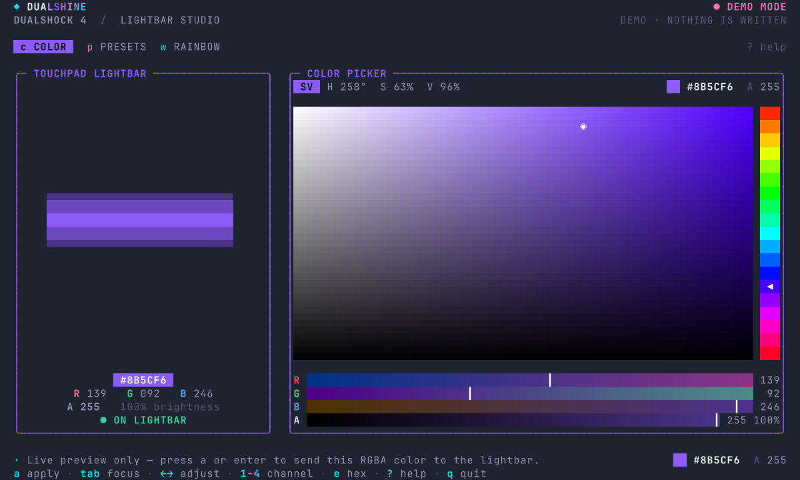
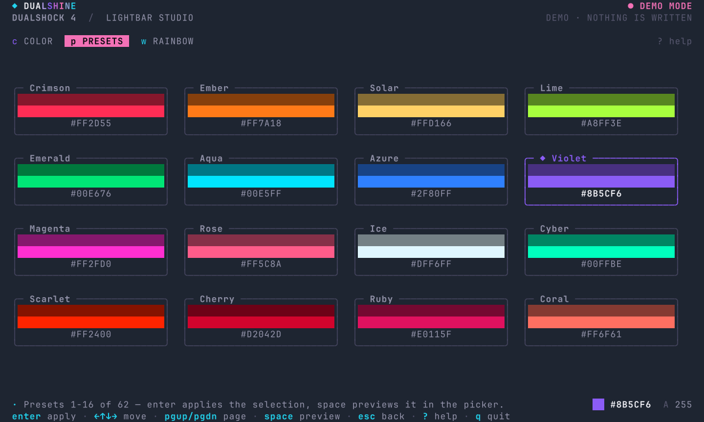
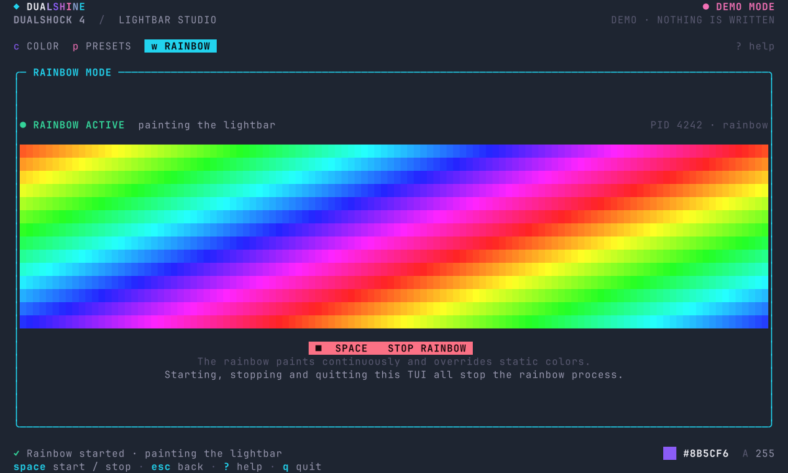
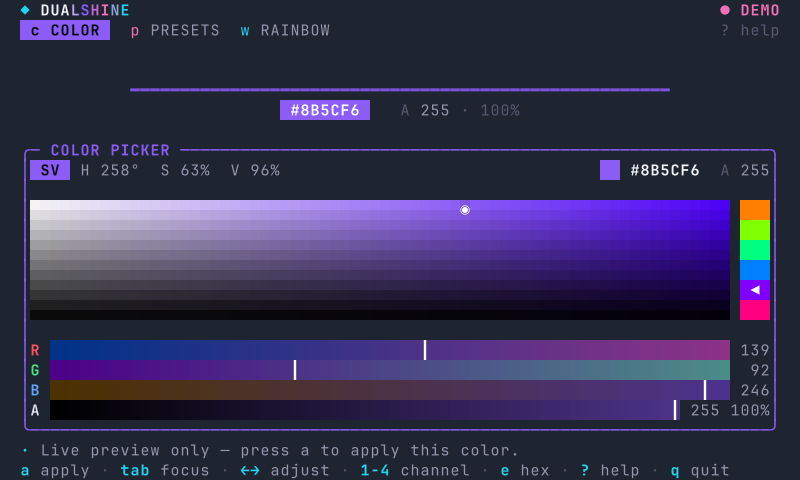
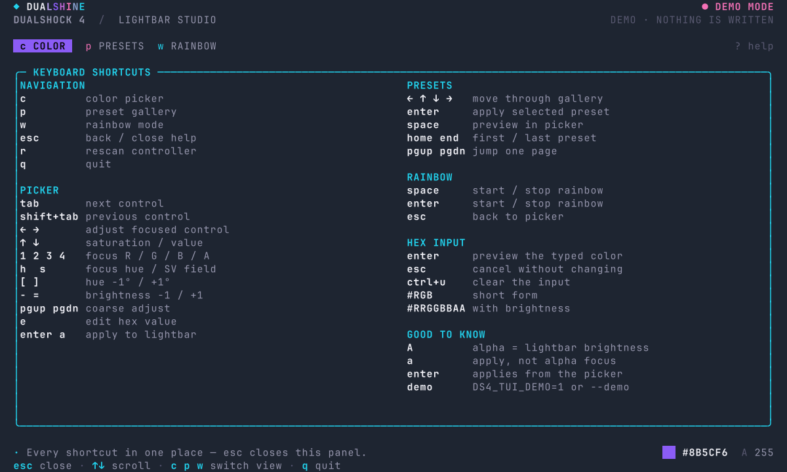

<p align="center">
  
</p>

<h1 align="center">DUALSHINE</h1>

A DualShock 4 lightbar studio for the terminal, built with
[Bubble Tea](https://github.com/charmbracelet/bubbletea) and
[Lip Gloss](https://github.com/charmbracelet/lipgloss).

Pick an RGBA color with a live truecolor preview, browse presets, or hand the
lightbar over to a rainbow. Nothing is written to the controller until you ask
for it.

Repository: **https://github.com/lxBlazarxl/dualshine**

New here? See **[Setup and run](docs/SETUP.md)** for a step-by-step fresh
install, prerequisites, permissions and uninstall instructions.

## Quick start

```bash
# 1. Check the external helpers this project drives
command -v ds4-led ds4-rb

# 2. Build
make build

# 3. Check that nothing is missing
./bin/ds4-tui --doctor

# 4. Try the UI without hardware
./bin/ds4-tui --demo

# 5. Run with the controller
./bin/ds4-tui
```

If the status says `NEEDS SUDO`, either let `ds4-led`/rainbow prompt once, or
run the one-time permission setup:

```bash
sudo ./scripts/install-udev.sh
```

Then press `r` in the TUI. Full details: [docs/SETUP.md](docs/SETUP.md).



*Screenshots use a slate terminal background to demonstrate the transparent
chrome. Color controls and swatches remain fully colored.*

## Highlights

- **HSV color field + hue strip + R/G/B/A sliders.** `A` is the alpha channel,
  used as lightbar brightness (0 = off, 255 = full).
- **A real preview.** The touchpad lightbar is rendered as a glowing strip,
  scaled by alpha, so you can judge the color before applying it.
- **Presets and direct hex entry.** 62 curated presets, plus `#RGB`, `#RGBA`,
  `#RRGGBB` and `#RRGGBBAA` input for exact values.
- **Rainbow mode.** Runs `ds4-rb` when the LEDs are writable, or asks for sudo
  once and runs a fixed privileged helper when they are root-owned. Either way
  it stops a competing `ds4-led` keeper first and shuts down with the TUI.
- **Transparent by default.** The base layer and card panels use the terminal's
  own background, so a transparent terminal/wallpaper shows through. Color
  swatches, the picker, sliders and the preview keep their colors. Pass
  `--opaque` for the old solid dark plate.
- **Responsive by construction.** Every screen is laid out from the current
  terminal size. It works down to 36×13 cells, has a dedicated tiny-terminal
  fallback, and caps/centers itself on very large terminals.
- **Permission-aware.** If the Lightbar sysfs files are writable it applies
  asynchronously. If they are root-owned, it hands the terminal to `ds4-led`
  so `sudo` can prompt normally.
- **Demo mode.** Explore the whole UI without a controller or hardware writes.
- **Monochrome fallback.** `NO_COLOR` / `TERM=dumb` gets a readable
  character-cell version instead of a broken color approximation.

### Presets



### Rainbow



At 80×24 the same screens collapse to a single column, keeping the preview,
picker, all four sliders and the full key bar:



## Platform support

**Linux only today.** The hardware backend uses `/sys/class/leds`, Linux
process groups, `sudo`, and the `ds4-led`/`ds4-rb` shell scripts. A native
Windows build currently does not compile, and macOS is not supported.

WSL2 is not officially supported. It may work when a USB DS4 is passed through
to WSL with `usbipd` and the Linux `hid-sony` driver exposes LED class devices,
but Bluetooth passthrough and LED access vary by setup. Native Windows support
would need a separate HIDAPI-based backend instead of sysfs/scripts.

### Kernel and driver requirements

For a step-by-step repair decision tree — including sysfs mounts, kernel
config checks, distro kernel installation, `hid-sony`, permissions, and
containers/WSL — see **[LED support troubleshooting](docs/LED-SUPPORT.md)**.

The sysfs backend is not guaranteed to exist on every Linux system. It needs:

- `CONFIG_LEDS_CLASS` (`y` or `m`) for `/sys/class/leds`.
- `CONFIG_HID_SONY` (`y` or `m`) for the DS4 LED class entries.
- The controller bound to `hid-sony` (not hidden by a userspace driver).
- A mounted `sysfs` and udev for unprivileged access.

Standard desktop distributions generally include these. Minimal, embedded,
container, Android, and WSL kernels may not. The path names are dynamic
(`input39:red`, etc.); DUALSHINE globs for them, but it cannot create them.

The presence of `/sys/class/leds` alone is not sufficient: it also contains
keyboard and network LEDs. There must be DS4 `*:red`, `*:green`, and `*:blue`
entries.

Useful checks:

```bash
ls /sys/class/leds
lsmod | grep hid_sony
sudo modprobe hid-sony          # only if the module exists
dmesg | grep -i sony
grep -E 'CONFIG_LEDS_CLASS|CONFIG_HID_SONY' /boot/config-$(uname -r)
```

`--doctor` now reports the kernel LED class, `hid-sony` state, and any Sony
`/dev/hidrawN` device it can see. The full repair guide is in
[LED support troubleshooting](docs/LED-SUPPORT.md).

### If the kernel does not expose the LED class

The TUI still launches in this case. The picker, preview, presets, hex input,
and demo mode all work; **Apply and Rainbow report an error** because there is
no sysfs path to write. The header shows `NO LED CLASS` / `SYSFS UNAVAILABLE`.

Try, in order:

1. Load the driver if it exists:

   ```bash
   sudo modprobe hid-sony
   ```

   Reconnect the controller and press `r`.

2. Install or boot a kernel built with `CONFIG_LEDS_CLASS` and
   `CONFIG_HID_SONY`. Standard desktop distribution kernels normally include
   these; minimal or custom kernels may not.

3. Check whether the controller is hidden by another driver:

   ```bash
   dmesg | grep -i sony
   lsusb | grep -i sony
   ls /sys/bus/hid/drivers/
   ```

   A userspace tool such as `ds4drv` or Steam Input can claim the device. Stop
   it, replug, and retry.

If a Sony `/dev/hidrawN` device exists but no LED class entries do, the kernel
has exposed the HID device but not the LED interface. A direct HID output
backend could use that path, but it is **not implemented** in the current
sysfs-backed version. In that situation today, use a kernel with `hid-sony`
or run `--demo` for the UI/preview.

There is no way for DUALSHINE to create `/sys/class/leds` entries; only the
kernel driver can. If neither the LED class nor a supported driver is
available, the app can run as a preview/demo tool but cannot drive the
lightbar.

## Requirements

- Linux and a DualShock 4 connected over USB or Bluetooth.
- The external `ds4-led` helper in `PATH` (not bundled with this project):
  - `ds4-led <r> <g> <b> [brightness]`
  - `ds4-led --stop`
- The external `ds4-rb` helper in `PATH` for the writable-LED rainbow path. If
  the LED files are root-owned, the TUI uses its sudo-assisted helper instead.
- `sudo` for read-only LED files, both for `ds4-led`'s elevation and for the
  one-time rainbow authentication.
- Go 1.24+ to build, and `make` for the convenience targets (plain `go build`
  also works).
- A terminal with truecolor support is strongly recommended for the preview,
  picker and gradients.
- Transparent mode assumes a dark terminal background. If you use a light
  background, `--opaque` keeps the interface readable.

## Dependencies

DUALSHINE is **not** dependency-free. There are three separate layers.

### Runtime system dependencies

| Dependency | Needed for |
| --- | --- |
| Linux with `CONFIG_LEDS_CLASS` and `hid-sony` | The controller lightbar interface |
| A DualShock 4 over USB or Bluetooth | Real hardware use |
| `ds4-led` on `PATH` | Applying/keeping static colors and stopping a keeper |
| `ds4-rb` on `PATH` | Rainbow mode when the LED files are writable |
| `sudo` + `bash` | Read-only LED apply/rainbow fallback |
| `udevadm` | Optional one-time permission setup only |

There is no network service, database, daemon, Python, or Node.js runtime
dependency. Demo mode needs only the Go binary.

### Direct Go modules

These are pinned in [`go.mod`](go.mod):

| Module | Version | Used for |
| --- | --- | --- |
| `github.com/charmbracelet/bubbletea` | v1.3.10 | TUI runtime and messages |
| `github.com/charmbracelet/lipgloss` | v1.1.0 | Styling and layout helpers |
| `github.com/charmbracelet/x/ansi` | v0.11.6 | ANSI width and truncation |
| `github.com/muesli/termenv` | v0.16.0 | Color-profile selection |
| `golang.org/x/sys` | v0.38.0 | `unix.Access` LED permission checks |

The 17 indirect modules are pinned in [`go.mod`](go.mod) and [`go.sum`](go.sum)
and are managed automatically. `go mod verify` checks the module cache.

### Build dependencies

- Go 1.24 or newer.
- `make` is optional; plain `go build` works.
- The first build downloads Go modules unless they are already cached.
- The Go modules are compiled into the executable; no Go toolchain or module
  files are needed at runtime.
- The prebuilt `bin/ds4-tui` is a Linux x86-64/glibc build. Build from source
  for a different architecture or libc.

## Check your setup

Before launching the TUI, run the preflight check:

```bash
./bin/ds4-tui --doctor
# or, from source:
make doctor
```

It reports `OK`, `WARN`, `FAIL`, and `INFO` for the platform, kernel LED
class, `hid-sony`, Sony hidraw devices, Go toolchain, `make`, `ds4-led`,
`ds4-rb`, controller/LED permissions, `sudo`, `bash`, `udevadm`, the udev rule,
TTY support, and color capability.

- Exit `0`: no hard blockers. Warnings may include “no controller connected”
  or “read-only LEDs”; demo mode still works.
- Exit `1`: a required dependency or platform requirement is missing.

The doctor never prompts for a password and never writes to the controller.

## Build and run

```bash
# Fresh clone
git clone https://github.com/lxBlazarxl/dualshine.git
cd dualshine

make build
./bin/ds4-tui          # transparent chrome
./bin/ds4-tui --opaque # solid dark background
```

Or build/run directly from source:

```bash
go build -o bin/ds4-tui ./cmd/ds4-tui
go run ./cmd/ds4-tui
```

Install into `~/.local/bin` (override with `PREFIX=/usr/local`). The target
directory must be on `PATH`:

```bash
make install
```

### Try it without hardware

```bash
./bin/ds4-tui --demo
# or
DS4_TUI_DEMO=1 ./bin/ds4-tui
```

Demo mode reports a connected virtual controller. Colors and rainbow are
simulated and nothing is written to sysfs.

## Command-line options

| Option | Meaning |
| --- | --- |
| `--demo` | Virtual controller; no hardware writes. |
| `--doctor` | Dependency/hardware preflight, then exit. |
| `--opaque` | Solid dark background instead of transparent chrome. |
| `--version` | Print the version. |
| `--help` | Print the flag summary. |

## Keys

### All screens

| Key | Action |
| --- | --- |
| `c` / `p` / `w` | Color picker / Presets / Rainbow |
| `r` | Rescan for a controller |
| `?` | Keyboard shortcuts (scrollable) |
| `esc` | Back / close help |
| `q` or `ctrl+c` | Quit |

### Color picker

| Key | Action |
| --- | --- |
| `tab` / `shift+tab` | Next / previous control |
| `←` `→` / `↑` `↓` | Adjust the focused control |
| `1` `2` `3` `4` | Focus R / G / B / A |
| `h` / `s` | Focus the hue strip / saturation-value field |
| `[` / `]` | Hue −1° / +1° |
| `-` / `=` | Brightness (alpha) −1 / +1 |
| `pgup` / `pgdn` | Coarse adjustment |
| `e` | Edit a hex value |
| `enter` or `a` | Apply the color |

The alpha slider is the fourth RGBA channel. Values are 0–255, with the
equivalent brightness percentage shown next to it.

### Presets

| Key | Action |
| --- | --- |
| `←` `↑` `↓` `→` | Move through the gallery |
| `home` / `end` | First / last preset |
| `pgup` / `pgdn` | Jump one page |
| `enter` or `a` | Apply the selected preset |
| `space` | Preview it in the picker without applying |

### Rainbow

| Key | Action |
| --- | --- |
| `space` or `enter` | Start / stop the rainbow |
| `esc` | Back to the picker |

### Hex input

| Key | Action |
| --- | --- |
| `enter` | Load the color into the picker (preview only) |
| `esc` | Cancel |
| `ctrl+u` | Clear the input |

Accepted formats: `#RGB`, `#RGBA`, `#RRGGBB`, `#RRGGBBAA`, with or without the
leading `#`.

Press `?` anywhere for the same reference inside the TUI. The help panel is
scrollable and paged when it does not fit:



## How it talks to the controller

The TUI does not write LED values directly.

**Static colors** are applied by running:

```bash
ds4-led <r> <g> <b> <brightness>
```

in the script's default persistent mode, so the chosen color keeps being
re-asserted if Steam Input or another tool tries to take the lightbar back.
The starting color is read from the controller so the picker reflects what is
currently lit.

`ds4-led` has an ambiguous brightness syntax: values 0–100 mean percent, while
101–255 mean raw 8-bit values. DUALSHINE maps its 0–255 alpha through that
syntax (alpha ≤100 is passed as a percentage) so the hardware brightness stays
linear across the entire slider. For example, `A 50` is sent as `20%`.

If the LED files are not writable, applying suspends the TUI and runs
`ds4-led` on the real terminal, which lets the script's built-in `sudo` prompt
work normally. If they are writable, the apply happens in the background and
the UI stays live.

### Remove the sudo prompts permanently

The DS4 LED sysfs files are created root-owned, so this is a one-time system
fix. Run:

```bash
cd /path/to/dualshine
sudo ./scripts/install-udev.sh
# or
make setup-led
```

The script:

- installs `/etc/udev/rules.d/99-dualshock4-led.rules`;
- grants your primary group write access to Sony (`054c`) DS4 LED brightness
  files;
- fixes the currently connected controller immediately;
- reloads udev and triggers a change event.

After that, press `r` in the TUI. The badge should say `DS4 READY`, applying
will no longer pause for sudo, and rainbow mode uses `ds4-rb` directly. To undo:

```bash
sudo rm /etc/udev/rules.d/99-dualshock4-led.rules
```

**Rainbow mode** first stops any `ds4-led` keeper, otherwise the two would
fight over the lightbar.

- If the LED files are writable, the TUI runs `ds4-rb` in its own process group
  and stops it with `SIGINT` on request or quit.
- If the LED files are root-owned, pressing space opens a normal `sudo -v`
  prompt. After authentication, the TUI starts a small fixed helper through
  `sudo -n` that reproduces the ds4-rb color cycle. The helper runs only while
  the TUI is alive: it watches the TUI process and a private stop file, so it
  exits within a frame when you stop the rainbow, quit, or the TUI crashes.
  This avoids the `ds4-rb` permission error without leaving a root process
  behind.

If sudo is cancelled or fails, the TUI reports it in the status line and does
not start the rainbow.

## Troubleshooting

| Symptom | Fix |
| --- | --- |
| Not sure what is missing | Run `./bin/ds4-tui --doctor` (or `make doctor`). |
| `NO DS4` badge | Connect the controller over USB or Bluetooth and press `r`. |
| `Read-only LEDs` / sudo every apply | Run `sudo ./scripts/install-udev.sh` once, then press `r`. |
| `ds4-led was not found in PATH` | Put `ds4-led` in `PATH` or `~/.local/bin`. |
| `ds4-rb was not found in PATH` | Put `ds4-rb` in `PATH` or `/usr/local/bin`. |
| Rainbow asks for a password | That is expected when the LED files are root-owned. Authenticate once; the helper then runs in the background. Cancel it to abort. |
| `sudo authentication failed or was cancelled` | Enter the password once, carefully; it is not echoed. Do not retry 3× — check `faillock --user "$USER"` if needed. Or configure writable LEDs via udev. |
| Account locked after sudo attempts | Run `faillock --user "$USER"` then `faillock --user "$USER" --reset`, or wait for the lockout timeout. |
| `could not stop the running ds4-led color keeper` | The old keeper is root-owned and sudo was not available. Run `sudo ds4-led --stop`, then start the rainbow again. |
| Colors look flat | Your terminal may not support truecolor, or `NO_COLOR` is set. DUALSHINE shows a monochrome fallback in that case. |
| Windows / macOS | Not supported natively. The hardware backend is Linux-only; see [Platform support](#platform-support). |
| `/sys/class/leds` missing | Kernel lacks `CONFIG_LEDS_CLASS` or sysfs is not mounted; see [LED support troubleshooting](docs/LED-SUPPORT.md#a-sysclassleds-is-missing). The TUI still runs in preview/demo mode. |
| No DS4 `*:red`/`*:green`/`*:blue` entries | `hid-sony` is missing or not bound. See [LED support troubleshooting](docs/LED-SUPPORT.md#b-led-class-exists-but-there-are-no-ds4-entries). |
| Sony hidraw exists, no LED class | The current sysfs backend cannot use hidraw. Enable `hid-sony` or run `--demo`; direct HID output is not implemented. |
| Window too small | The minimum full layout is 36×13. Below that, a compact notice tells you the required size. |
| Text is hard to read over a busy wallpaper | Run with `--opaque`, or use a darker/less busy terminal background. |

## Development

Full fresh-install instructions live in [docs/SETUP.md](docs/SETUP.md).

```bash
make deps         # download Go modules
make verify-deps  # verify the module cache
make doctor       # check dependencies, permissions and hardware
make test         # unit tests
make race         # tests under the race detector
make vet          # go vet
make demo         # run the UI with a virtual controller
```

The code is split into:

- `internal/color` — RGBA/HSV math, hex parsing, contrast, brightness scaling.
- `internal/picker` — HSV + alpha editing state.
- `internal/ds4` — controller detection, `ds4-led` invocation, and `ds4-rb`
  process lifecycle. Includes a demo backend.
- `internal/tui` — Bubble Tea model/update/view, responsive layout, picker,
  presets, rainbow and help screens.

Layout tests render every screen at sizes from 1×1 through 300×100 and assert
that each view has exactly the requested number of lines and never exceeds the
requested width.
